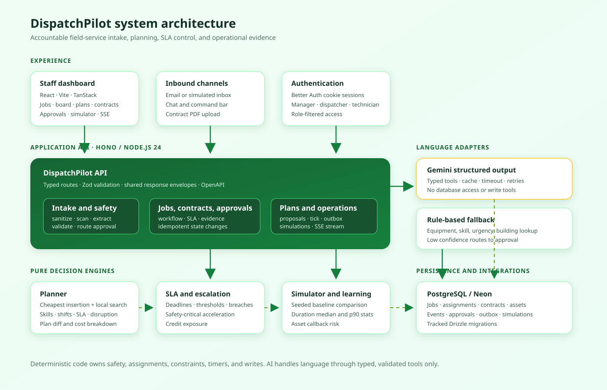

# dispatchpilot

**Open-source field-service operations platform for intelligent dispatching**

A platform that helps facilities teams receive service requests, extract structured jobs from messy messages, enforce safety and SLA rules, plan technician routes, and review every automated decision. It connects managers, dispatchers, technicians, contracts, and operational evidence through a shared web application and API.

*Built for accountable service operations.*

---

## Key Features

- Defended **message and contract intake** with Gemini structured extraction, Zod validation, deterministic safety scanning, and a rule-based fallback
- Deterministic **planning and re-planning** with skills, shifts, SLA deadlines, travel, overtime, balance, and disruption costs
- **Human approval workflows** for emergencies, low-confidence extraction, contract activation, and plan proposals
- Contract-driven **SLA timers, escalation ladders, evidence packs, and dry-run notifications** through an idempotent outbox
- **Event-sourced operational history** for jobs, assignments, approvals, plans, technician updates, and outbound messages
- **Seeded simulator and benchmark** comparing the planner with a nearest-technician baseline
- **Asset health and duration learning** from closed jobs and callbacks
- Role-based web dashboard for managers, dispatchers, and technicians with live API data and SSE updates

## Architecture



The platform has four layers:

1. **Experience** — The React/Vite dashboard uses TanStack Router and Query, shadcn/ui, Phosphor Icons, and Better Auth. Managers and dispatchers see the operational board, jobs, plan review, contracts, assets, simulator, approvals, and activity; technicians see their assigned work.
2. **Application** — The Hono API on Node.js 24 owns authentication, role enforcement, intake, job workflow, contract approval, planning proposals, SLA ticks, simulations, evidence, outbox processing, and the authenticated SSE stream.
3. **Decision engines** — `packages/engine` contains pure deterministic planner, SLA, and simulation logic. Gemini performs language tasks only; application code validates its typed output and makes all safety, assignment, timing, and approval decisions.
4. **Persistence and adapters** — PostgreSQL/Neon stores domain state, append-only events, approvals, assignments, outbox rows, duration statistics, asset events, and simulation runs. Adapter boundaries provide Gemini/fallback parsing, haversine travel, geocoding, and dry-run mail.

Inbound messages are sanitized and wrapped as untrusted data before deterministic safety triage and typed extraction. Safety hits cannot be removed by the model. Every state change writes an event, and every outbound message goes through the outbox.

## Workspace Overview

```
dispatchpilot
├── apps/back-end          # Hono API, Better Auth, Drizzle schema and services
├── apps/front-end         # React/Vite dashboard and live API data layer
├── packages/shared        # Shared Zod schemas, roles, and API types
├── packages/engine        # Pure planner, SLA, and simulator engines
├── eval                   # Labelled extraction and prompt-injection fixtures
├── sim                    # Seeded benchmark CLI
├── docs                   # PRD, SRS, API reference, and implementation plan
├── Dockerfile             # Node 24 backend container
└── architecture.svg       # System architecture diagram
```

---

## Packages and Services

### [`apps/back-end`](apps/back-end)

The central API and domain service.

- Better Auth cookie sessions with exactly three staff roles: manager, dispatcher, and technician
- Hono routes under `/api/v1`, shared response envelopes, Zod boundary validation, and Scalar/OpenAPI documentation
- Intake endpoints for messages and commands, including Gemini/fallback extraction, safety precedence, idempotency, and approval routing
- Job, technician, contract, asset, plan proposal, simulation, evidence, internal tick, and event-stream endpoints
- Drizzle ORM with tracked migrations and an idempotent development seed
- Private contract PDF storage, manager-only activation, dry-run mail, scheduler protection, and structured logging

See [`docs/API.md`](docs/API.md) and the live Scalar docs at `http://localhost:3001/docs`.

---

### [`apps/front-end`](apps/front-end)

React single-page application for dispatch operations.

- TanStack Router for file-based routes and TanStack Query for server state
- Live API adapter selected with `VITE_USE_MOCK_DATA=false`
- Dispatch board, jobs, plan review, contracts/SLA, assets, simulator, approvals/activity, settings, and technician views
- SSE invalidation with polling-compatible query hooks
- Responsive shadcn/ui components with the DispatchPilot green status palette
- Mock data remains available only through the typed `mocks` adapter for demos and offline UI work

---

### [`packages/shared`](packages/shared)

Shared contracts consumed by the backend, frontend, and tests.

- Strict Zod schemas for jobs, contracts, approvals, assignments, events, simulations, and API envelopes
- Role, status, equipment, skill, urgency, and safety enums
- Types used by both live and mock data-access adapters

---

### [`packages/engine`](packages/engine)

Pure TypeScript decision engines with no database or network calls.

- Cheapest-insertion construction followed by bounded relocate, swap, and 2-opt improvement
- Hard constraints for skills, shifts, overlaps, and critical SLA reachability
- Cost breakdowns for travel, SLA lateness, overtime, balance, and promised-job disruption
- SLA deadlines, escalation thresholds, and credit exposure calculations
- Seeded simulator with normal, heat-wave, and sick-leave scenarios

The same input and seed produce the same plan and simulation result.

---

### [`eval`](eval)

Evaluation fixtures and runner for the AI intake boundary.

- Labelled messages covering typos, multiple equipment types, missing fields, urgency, and safety language
- Prompt-injection cases covering overrides, role-play, hidden text, exfiltration requests, and fake system messages
- CI-safe fallback evaluation plus recorded-fixture compatibility for Gemini
- Reports field-level accuracy and injection invariance without requiring a live key

---

### [`sim`](sim)

Seeded benchmark command-line interface.

- Compares nearest-technician baseline and DispatchPilot planner policies
- Reports simulated SLA hit rate, travel minutes, moved jobs, overtime, seed, scenario, and duration
- Supports repeatable what-if roster experiments through the simulation engine

---

## Quick Start

```sh
pnpm install
cp apps/back-end/.env.example apps/back-end/.env
cp apps/front-end/.env.example apps/front-end/.env
```

Set `DATABASE_URL`, `BETTER_AUTH_SECRET`, `BETTER_AUTH_URL`, `WEB_APP_URL`, and `CORS_ORIGINS` in `apps/back-end/.env`. Add `GEMINI_API_KEY` only when live extraction is wanted; the rule-based fallback keeps local development and CI working without it. Never commit `.env` files or expose API keys in logs.

Initialize a non-production database:

```sh
pnpm --filter @dspv2/backend db:migrate
pnpm --filter @dspv2/backend seed
```

Start the API and dashboard:

```sh
pnpm dev
```

| Service | Port | Description |
|---------|------|-------------|
| `apps/back-end` | 3001 | Hono API, auth, Scalar docs, and SSE stream |
| `apps/front-end` | 5173 | Vite web dashboard |
| PostgreSQL/Neon | configured by `DATABASE_URL` | Domain and event storage |

Open `http://localhost:5173` for the dashboard and `http://localhost:3001/docs` for the API reference. The seed creates one development account for each staff role; credentials are documented in the local ignored `credentials.md` file.

## Development

The project uses Node.js 24 and pnpm 11.23.0:

```sh
pnpm typecheck
pnpm lint
pnpm test
pnpm build
pnpm format:check
```

Run the intake evaluation and seeded benchmark:

```sh
pnpm eval
pnpm sim run --days 100 --seed 42 --scenario all
```

Simulation output is labelled `simulated=true` and must be interpreted as seeded benchmark data, not production performance. The API can also run simulations and the dashboard reads those persisted results through the live adapter.

## API and Operations

- API reference: [`docs/API.md`](docs/API.md), `/docs`, and `/openapi.json`
- Health: `/api/v1/health` and `/api/v1/ready`
- Intake: `POST /api/v1/intake/messages` and `POST /api/v1/intake/command`
- Plans: `/api/v1/plans/proposals` and approval/rejection endpoints
- Scheduler: `POST /api/v1/internal/tick`, `/nightly`, and `/daily`
- Live updates: authenticated `GET /api/v1/stream`
- Evidence: `GET /api/v1/sla/compliance` and `GET /api/v1/sla/evidence-pack`

Outbound messages are dry-run by default. Contract rules remain drafts until a manager approves them. Re-plans remain proposals unless the auto-pilot setting is explicitly enabled.

## Cloudflare Deployment

The dashboard deploys to Cloudflare Pages and the Hono API has a Cloudflare Workers entry point using Node compatibility. The API uses the same PostgreSQL/Neon connection through the `DATABASE_URL` Worker secret; Hyperdrive can be added later for connection pooling. Do not upload a `.env` file: put each value into Cloudflare as a secret or variable.

Create the Pages project, set the frontend API origin for the build, and deploy:

```sh
pnpm dlx wrangler@latest pages project create dispatchpilot-web
VITE_API_URL=https://dispatchpilot-api.<your-subdomain>.workers.dev pnpm cloudflare:build
pnpm dlx wrangler@latest pages deploy apps/front-end/dist --project-name dispatchpilot-web --config wrangler.pages.jsonc
```

Deploy the API Worker after adding its secrets through the terminal:

```sh
printf '%s' "$DATABASE_URL" | pnpm dlx wrangler@latest secret put DATABASE_URL --config wrangler.worker.jsonc
printf '%s' "$BETTER_AUTH_SECRET" | pnpm dlx wrangler@latest secret put BETTER_AUTH_SECRET --config wrangler.worker.jsonc
printf '%s' "$BETTER_AUTH_URL" | pnpm dlx wrangler@latest secret put BETTER_AUTH_URL --config wrangler.worker.jsonc
printf '%s' "$WEB_APP_URL" | pnpm dlx wrangler@latest secret put WEB_APP_URL --config wrangler.worker.jsonc
printf '%s' "$CORS_ORIGINS" | pnpm dlx wrangler@latest secret put CORS_ORIGINS --config wrangler.worker.jsonc
printf '%s' "$GEMINI_API_KEY" | pnpm dlx wrangler@latest secret put GEMINI_API_KEY --config wrangler.worker.jsonc
pnpm cloudflare:api:deploy
```

Set non-secret Worker variables with `wrangler.toml`/`wrangler.jsonc` or the Cloudflare dashboard, including `NODE_ENV=production`, `DRY_RUN=true`, `GEMINI_MODEL`, `SCHEDULER_SECRET`, and `CONTRACT_UPLOAD_DIR`. Run database migrations against the production `DATABASE_URL` before the first Worker request. Never run the local `pnpm dev` seed flow with `NODE_ENV=production`.

For contract PDF uploads on Workers, create an R2 bucket and uncomment the `r2_buckets` binding in [`wrangler.worker.jsonc`](wrangler.worker.jsonc):

```sh
pnpm dlx wrangler@latest r2 bucket create dispatchpilot-contracts
```

## Roadmap

The following integrations are intentionally left behind adapter boundaries or require environment-specific setup:

- **Cloud Scheduler integration** — trigger the Worker tick, nightly, and daily endpoints on a schedule
- **Live email delivery** — Gmail or another provider after the dry-run outbox is approved
- **OSRM routing** — richer road travel times and route geometry beyond the haversine fallback
- **Calendar and weather integrations** — optional Google Calendar and weather surge signals
- **Requester tracking links** — private customer-facing status pages

The core workflow, fallback path, planner, approvals, evidence trail, simulator, and frontend API integration are implemented locally and covered by the repository checks.

---
