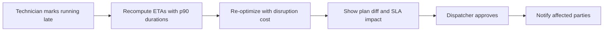
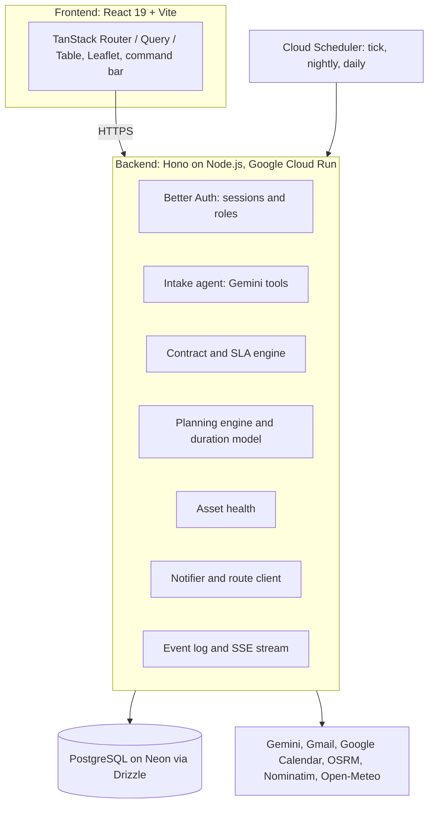

# DispatchPilot: Product Requirements Document (PRD)

|                      |                                                      |
| -------------------- | ---------------------------------------------------- |
| **Product**          | DispatchPilot, an AI field-operations platform       |
| **Author**           | Eureka T/Mariam                                      |
| **Context**          | Level 1 assignment for brain3.ai                     |
| **Version**          | 2 (post-review, based on SRS v2 of 11 November 2026) |
| **Status**           | Approved to implement                                |
| **Location in repo** | `/docs/PRD.md`                                       |

> A contract-aware AI dispatcher that plans the day, guarantees SLAs, and proves it.

---

## 1. Overview

DispatchPilot is a field-operations platform for companies that maintain commercial buildings (elevators, AC, refrigeration). It reads repair requests and maintenance contracts, plans and re-plans each technician's day with an optimization engine, enforces service-level agreements (SLAs), learns from completed work, and produces evidence of every response.

**Technology:** React 19, Hono, Drizzle, PostgreSQL, Zod, Better Auth. Runs entirely on free-tier services.

### 1.1 Origin of the idea

Nobody fixed the lift in our own office building, and the cause was not technical: it was a management problem. Repairs stall when nobody owns the request, nothing has a deadline, and no one follows up or escalates. DispatchPilot gives every request an **owner, a timer, and an escalation path**, so nothing waits quietly until someone remembers it.

## 2. Problem Statement

A human field-service dispatcher reads requests, checks what the contract promises, chooses technicians, plans routes, keeps people informed, chases late jobs, and re-plans whenever something changes. This work is repetitive, easy to forget under load, and hard to do around the clock.

| Pain                                      | Evidence (directional, mostly vendor sources; see SRS Appendix C) |
| ----------------------------------------- | ----------------------------------------------------------------- |
| Technicians spend much of the day driving | 2 to 4 hours a day, 25 to 50% of working time                     |
| Schedules break                           | 47% of appointments did not go according to schedule              |
| Manual elevator callback dispatch is slow | 18 to 23 minutes from notification to dispatch                    |
| SLA credits need proof                    | Customers recover credits only when they can prove arrival time   |
| Dispatchers are costly and shift-bound    | About $47,000 to $49,000 a year in the US                         |

## 3. Target Customer and Users

**Buyer:** owner or operations manager of a maintenance company with 5 to 20 technicians. Reference profile: about 8 technicians, 20 to 40 jobs a day, requests by email and chat, and contracts with response-time SLAs. Building managers benefit through SLA evidence.

| Role           | What they do in DispatchPilot                                                                         |
| -------------- | ----------------------------------------------------------------------------------------------------- |
| **Manager**    | Approves contracts and SLA rules, sets autonomy, runs simulator and what-if, manages users and skills |
| **Dispatcher** | Reviews and approves plans, reassigns jobs, handles exceptions and escalations                        |
| **Technician** | Sees own jobs, updates status (on my way, running late, done)                                         |
| **Requester**  | Receives confirmation, ETA, and delay notices; tracks the request through a private link (no account) |

## 4. Goals and Non-Goals

### Goals

1. Give every job an owner and an SLA timer. **Zero** jobs without an owner or deadline.
2. Cut time from request to proposed assignment to under 30 seconds.
3. Plan under contract terms with minimal disruption when things change.
4. Enforce SLAs automatically and prove compliance with timestamped evidence.
5. Make every claim measurable through a seeded simulator and benchmark.
6. Keep a human in control of approvals, exceptions, and safety decisions.

### Non-Goals (roadmap, not in MVP)

- Invoicing and payments
- Parts inventory
- Native technician mobile app (status buttons simulate it)
- Requester photo and voice intake
- Technician manual-search copilot
- Preventive-maintenance gap filling
- Multiple companies sharing one deployment (multi-tenancy)

## 5. Product Features

### 5.1 Differentiating features

| ID  | Feature                         | Description                                                                                                                                                                                           |
| --- | ------------------------------- | ----------------------------------------------------------------------------------------------------------------------------------------------------------------------------------------------------- |
| P1  | **Contract and SLA engine**     | Reads a maintenance contract PDF into priority tiers, response times, callback limits, and credits. Turns them into rules and live timers. Produces a monthly evidence pack of timestamped responses. |
| P2  | **Asset registry and health**   | Every lift or AC unit has a service history. Repeated callbacks raise a risk score and a recommended inspection.                                                                                      |
| P3  | **Capacity what-if**            | Replays a typical week in the simulator with different staffing and shows projected SLA compliance and travel.                                                                                        |
| P4  | **Plan review and explanation** | Every re-plan shows a before-and-after diff with reason, SLA impact, and one-click approval.                                                                                                          |
| P5  | **Safety-aware triage**         | Safety language (for example a person trapped in a lift) takes the emergency path with the fastest escalation.                                                                                        |

### 5.2 Core agent capabilities

| #   | Capability                                                   | Priority |
| --- | ------------------------------------------------------------ | -------- |
| 1   | Job intake and triage from email and chat                    | P1       |
| 2   | Contract ingestion into SLA rules, approved by a manager     | P1       |
| 3   | Planning and assignment with an explanation                  | P1       |
| 4   | Delay handling and minimal-disruption re-optimization        | P1       |
| 5   | SLA tracking and three-level escalation                      | P1       |
| 6   | Simulation and benchmarking                                  | P1       |
| 7   | Duration learning (median and 90th percentile)               | P2       |
| 8   | Asset history and repeat-failure detection                   | P2       |
| 9   | Requester communication (confirmation, ETA, progress, delay) | P2       |
| 10  | Calendar sync and weather planning                           | P3       |
| 11  | Reporting: morning plan, weekly brief, monthly evidence pack | P2       |

### 5.3 Autonomy and control

- Approval queue for emergencies and low-confidence jobs
- Auto-pilot toggle and confidence threshold (manager only)
- Dry-run mode: shows what would be sent without sending
- Command bar for natural-language requests, such as "Technician Dawit is stuck in traffic, move his 2 pm job" or "What if we add one elevator technician?"
- Approve, reject, reassign, drag a job to another technician, and edit a message before it is sent
- Proactive checks every 5 minutes, nightly, and every morning and week

| Action                                            | Trigger                        | Autonomy                                                |
| ------------------------------------------------- | ------------------------------ | ------------------------------------------------------- |
| Create job record                                 | New email or chat message      | Auto                                                    |
| Assign technician                                 | Job triaged                    | Auto (routine) / Approval (emergency or low confidence) |
| Activate SLA rules from a contract                | Contract uploaded and parsed   | Manager approval                                        |
| Send confirmation and ETA                         | Assignment confirmed           | Auto                                                    |
| Re-plan after a delay                             | Technician late or unavailable | Approval by default (plan diff); auto-pilot optional    |
| Escalate a job nearing its SLA                    | Time-to-deadline threshold     | Auto, three levels                                      |
| Recommend an asset inspection                     | Repeat-failure threshold       | Manager approval                                        |
| Update duration and asset statistics              | Job closed                     | Auto                                                    |
| Morning plan, weekly brief, monthly evidence pack | Schedule                       | Auto                                                    |

## 6. Core Workflows

### W1: New job (happy path)

Routine jobs are fully automatic. Low-confidence extractions and emergencies go to the approval queue first.

### W2: Technician delay (demo centrepiece)

### W3: SLA escalation (the lift problem, solved)

Escalation timing follows the contract tier. Safety-critical jobs escalate fastest.

### W4: Contract onboarding

Manager uploads contract PDF → Gemini extracts terms → Zod validates and flags unclear text → manager reviews and approves → rules go live as SLA timers → monthly evidence pack.

### W5: Learning and asset health

Job closes → update asset history → update duration statistics → repeat-failure check → raise risk score → recommend inspection job.

## 7. Functional Requirements

| ID    | Requirement                                                                                                                                                                               | Priority |
| ----- | ----------------------------------------------------------------------------------------------------------------------------------------------------------------------------------------- | -------- |
| FR-1  | Ingest requests from email (Gmail) and a chat or command box, and create a job record                                                                                                     | P1       |
| FR-2  | Extract structured fields with Gemini, validate with Zod, and flag low-confidence results                                                                                                 | P1       |
| FR-3  | Detect safety-critical language and route the job to the emergency path                                                                                                                   | P1       |
| FR-4  | Geocode addresses and cache the coordinates                                                                                                                                               | P1       |
| FR-5  | Let technicians update status (on my way, running late, done) and recompute ETAs                                                                                                          | P1       |
| FR-6  | Apply hard constraints: skill, shift, availability, and no overlapping jobs                                                                                                               | P1       |
| FR-7  | Optimize the plan with a cost covering travel, SLA-weighted lateness, overtime, balance, and disruption, using insertion and local search, within 2 seconds for 8 technicians and 40 jobs | P1       |
| FR-8  | On a delay, re-optimize and show a before-and-after diff with reasons and SLA impact; apply on approval or when auto-pilot is on                                                          | P1       |
| FR-9  | Estimate job durations from history (median and p90); use p90 for SLA-critical jobs                                                                                                       | P2       |
| FR-10 | Extract SLA terms from a contract PDF into structured rules; activate only after manager approval                                                                                         | P1       |
| FR-11 | Attach an SLA timer to every job from its contract tier and escalate in three levels (technician, dispatcher, manager)                                                                    | P1       |
| FR-12 | Generate a monthly evidence pack of timestamped responses, with compliance and credit exposure on the dashboard                                                                           | P2       |
| FR-13 | Maintain an asset registry with the full service history of each unit                                                                                                                     | P2       |
| FR-14 | Detect repeat failures (for example 3 or more callbacks in 60 days) and recommend an inspection job                                                                                       | P2       |
| FR-15 | Run a seeded simulator of a working day and compare the planner with a nearest-technician baseline on SLA hit rate and travel                                                             | P1       |
| FR-16 | Provide what-if analysis: change staffing and see projected SLA compliance and travel                                                                                                     | P2       |
| FR-17 | Maintain an evaluation set that measures extraction accuracy, plus prompt-injection test cases                                                                                            | P2       |
| FR-18 | Provide role-based screens: dispatch board, jobs, plan review, contracts and SLA, assets, simulator, approvals and activity, my jobs, settings                                            | P1       |
| FR-19 | Record every state change as an event with its reasoning, and let users replay a day                                                                                                      | P1       |
| FR-20 | Update the board live through server-sent events, with polling as a fallback                                                                                                              | P2       |
| FR-21 | Email requesters a confirmation, ETA, delay notice, and completion message with a tracking link                                                                                           | P2       |
| FR-22 | Run scheduled checks every 5 minutes; send a morning plan and a weekly operations brief                                                                                                   | P2       |
| FR-23 | Create and update technician calendar events; flag weather-driven demand surges                                                                                                           | P3       |

## 8. Technical Features

| ID  | Feature                                | How it works                                                                                                                                                                                                                                                                                  |
| --- | -------------------------------------- | --------------------------------------------------------------------------------------------------------------------------------------------------------------------------------------------------------------------------------------------------------------------------------------------- |
| E1  | **Minimal-disruption planning engine** | Builds routes by cheapest insertion, then improves with relocate, swap, and 2-opt moves until a 2-second budget ends. Hard constraints on skill, shift, and overlap. Cost = travel + SLA-weighted lateness + overtime + imbalance + disruption (a penalty for moving a job already promised). |
| E2  | **Learned durations with uncertainty** | Median and 90th percentile per equipment type, technician, and building. Shrinks toward the equipment-type average when data is sparse. SLA-critical jobs plan with p90.                                                                                                                      |
| E3  | **Simulator and benchmark**            | Seeded digital twin of a working day. Compares the planner with a nearest-technician baseline and runs inside automated tests.                                                                                                                                                                |
| E4  | **Event-sourced core**                 | Every state change is an append-only event with reasoning, so a day can be replayed and any decision explained. An outbox sends each email exactly once. Server-sent events keep the board live.                                                                                              |
| E5  | **Defended AI layer**                  | Gemini acts only through typed, validated tools. Email text is never treated as instructions. An evaluation set measures extraction accuracy, and injection tests run in CI.                                                                                                                  |

**AI versus deterministic code**

| Gemini (language tasks)                                                                                     | Deterministic code (decisions and safety)                                                                                                                 |
| ----------------------------------------------------------------------------------------------------------- | --------------------------------------------------------------------------------------------------------------------------------------------------------- |
| Understand messy emails, extract job fields, read contracts into draft rules, draft messages, explain plans | Constraint filtering, optimization, time and distance maths, SLA timers, duration and asset statistics, idempotent actions, Zod validation, event logging |

## 9. Architecture

### 9.1 Tech stack

| Layer          | Choice                                                                             |
| -------------- | ---------------------------------------------------------------------------------- |
| Frontend       | React 19, Vite, TanStack Router / Query / Table, Leaflet (OSM tiles)               |
| Backend        | Hono on Node.js, hosted on Google Cloud Run                                        |
| Scheduling     | Cloud Scheduler (3 free jobs: 5-minute tick, nightly, daily and weekly)            |
| Database       | PostgreSQL (Neon) with Drizzle ORM                                                 |
| Authentication | Better Auth with Drizzle adapter, role-based access                                |
| Validation     | Zod on both sides (API input, LLM output, forms)                                   |
| Planning       | Custom TypeScript engine (insertion plus local search), runs in the API process    |
| AI             | Gemini Flash-class model (AI Studio key) with structured JSON output and PDF input |

### 9.2 Data model

| Table                    | Key fields                                                                                                                                             |
| ------------------------ | ------------------------------------------------------------------------------------------------------------------------------------------------------ |
| `jobs`                   | id, requester, address, lat/lng, equipment, asset_id, skill_required, urgency, safety_flag, status, confidence, contract_id, sla_due, escalation_level |
| `technicians`, `skills`  | technician: id, user_id, name, shift, status, current_lat/lng, workload. skills: skill and level per technician                                        |
| `assignments`            | job_id, technician_id, planned_start, eta, cost_breakdown (json), state (proposed / confirmed / reassigned)                                            |
| `contracts`, `sla_rules` | contract: id, customer, source_pdf, status. rule: tier, response_minutes, resolution_target, callback_cap, credit_terms                                |
| `assets`, `asset_events` | asset: id, site, type, install_date, health_score. event: asset_id, job_id, outcome, time_to_repair                                                    |
| `duration_stats`         | equipment_type, technician_id, building_id, n, median_minutes, p90_minutes                                                                             |
| `events`                 | append-only: type, payload, reasoning, autonomy (auto / approved), created_at                                                                          |
| `simulation_runs`        | seed, policy, sla_hit_rate, travel_minutes, jobs_moved, created_at                                                                                     |
| Better Auth              | user, session, account, verification, organization, member (with role)                                                                                 |

### 9.3 Roles and access

| Capability                                   | Manager | Dispatcher | Technician | Requester                    |
| -------------------------------------------- | ------- | ---------- | ---------- | ---------------------------- |
| Sign-in                                      | Account | Account    | Account    | None (private link by email) |
| View jobs and map                            | All     | All        | Own jobs   | Own request                  |
| Approve or reassign jobs and plans           | Yes     | Yes        | No         | No                           |
| Update job status                            | Yes     | Yes        | Own jobs   | No                           |
| View activity log, escalations, asset health | Yes     | Yes        | No         | No                           |
| Manage contracts and SLA rules               | Yes     | View only  | No         | No                           |
| Run simulator and what-if                    | Yes     | View only  | No         | No                           |
| Change autonomy settings                     | Yes     | No         | No         | No                           |
| Manage users, roster, skills                 | Yes     | View only  | No         | No                           |

The backend enforces access on every API route, and the UI hides pages a role cannot use.

## 10. Third-Party Integrations

Each integration sits behind an adapter (for example `getTravelTime(a, b)`) so a real client and a fallback are interchangeable.

| Service             | Used for                                                                         | Fallback                                                |
| ------------------- | -------------------------------------------------------------------------------- | ------------------------------------------------------- |
| Gemini API          | Extract jobs, read contract PDFs into draft rules, draft messages, explain plans | Rule-based parser, manual rule entry, message templates |
| Gmail API           | Read job emails; send confirmations, ETAs, delay notices, escalations            | Simulated inbox endpoint; logged outbound messages      |
| Google Calendar API | Create and update technician events                                              | Internal timeline view only                             |
| OSRM                | Drive times, distances, route lines                                              | Haversine distance with a speed factor                  |
| Nominatim           | Geocoding                                                                        | Pre-seeded coordinates                                  |
| Open-Meteo          | Heat-wave and storm forecasts                                                    | Skip the weather feature                                |

**Pattern:** adapter per service, cache and rate-limit in Postgres, parse every external response with Zod, make failures visible in the event log, and keep secrets in environment variables.

## 11. Screens

| Page                   | Purpose                                                         | Roles                          |
| ---------------------- | --------------------------------------------------------------- | ------------------------------ |
| Sign in                | Authenticate with Better Auth (email and password, Google)      | All                            |
| Dispatch Board         | Daily overview, KPI cards, technician timelines, re-planning    | Manager, dispatcher            |
| Jobs                   | Inbox, triage, cost explanation, approve or reassign            | Manager, dispatcher            |
| Plan Review            | Before-and-after diff, SLA impact, approve or reject            | Manager, dispatcher            |
| Map                    | Live positions, routes, ETA card, weather banner                | Manager, dispatcher            |
| Contracts and SLA      | Upload, rule review, compliance, credit exposure, evidence pack | Manager (dispatcher view only) |
| Assets                 | Asset list, risk score, history, create inspection job          | Manager, dispatcher            |
| Simulator              | Policy comparison charts and staffing what-if                   | Manager (dispatcher view only) |
| Approvals and Activity | Approval cards, event log with reasoning, day replay            | Manager, dispatcher            |
| My Jobs                | Own jobs, status buttons, navigation link                       | Technician                     |
| Settings               | Roster, skills, shift hours, auto-pilot toggle, dry-run switch  | Manager                        |

Single responsive web app with a left navigation, a command bar on top, and light and dark themes. Status colours: teal = ok, blue = scheduled, amber = needs attention, red = late or urgent.

## 12. Non-Functional Requirements

| Category        | Requirement                                                                                                                                                                      |
| --------------- | -------------------------------------------------------------------------------------------------------------------------------------------------------------------------------- |
| Security        | Better Auth sessions, role checks on every route, secrets in environment variables, HTTPS only, unguessable requester tokens, email and contract text treated as untrusted input |
| Privacy         | Demo uses synthetic data only; store only needed fields; send the LLM only what it needs                                                                                         |
| Reliability     | Idempotent actions, email outbox, retries with backoff, a fallback for every integration, all failures logged and shown                                                          |
| Performance     | Proposed assignment in under 30 s; planner under 2 s for 8 technicians and 40 jobs; main screens load in about 2 s on demo data                                                  |
| AI quality      | At least 90% extraction accuracy on the evaluation set; every prompt-injection test handled safely                                                                               |
| Usability       | Responsive layout, one-click approvals, plain-language explanations of every decision                                                                                            |
| Maintainability | Shared Zod schemas, layered routes / services / repositories, property tests covering the planner, end-to-end types                                                              |
| Cost            | Operate within the free tier of every service used                                                                                                                               |

## 13. Success Metrics

Targets are goals to measure with seeded data in the simulator, not claims about real deployments.

| Metric                            | Baseline                                             | Target                                                                  |
| --------------------------------- | ---------------------------------------------------- | ----------------------------------------------------------------------- |
| Time from request to assignment   | 18 to 23 minutes (manual elevator callbacks, vendor) | Under 30 seconds to a proposed assignment                               |
| Technician travel time            | Nearest-free-technician baseline                     | 15 to 25% lower in the simulator                                        |
| SLA compliance                    | Nearest-technician baseline                          | Higher than baseline across 100 simulated days                          |
| Plan stability after a delay      | Manual re-plan moves many jobs                       | Moves the fewest jobs that keep SLAs safe; count reported per delay     |
| Duration estimate accuracy        | Flat default per job type                            | Lower average error than the default after 50 completed jobs            |
| Extraction accuracy               | None                                                 | 90% or better on the evaluation set; all injection tests handled safely |
| Jobs without an owner or deadline | Common when ownership is unclear                     | Zero                                                                    |

## 14. Scope and Build Plan

### 14.1 Cut line

| Priority    | Items                                                                                                                                                                                                                                                                                                                                                                                       |
| ----------- | ------------------------------------------------------------------------------------------------------------------------------------------------------------------------------------------------------------------------------------------------------------------------------------------------------------------------------------------------------------------------------------------- |
| **Must**    | Authentication and roles; seeded data; email or chat intake with Gemini extraction and Zod validation; planning engine with hard constraints, cost function, re-optimization, and plan diff; SLA rules (from a contract, with manager approval), timers, and three-level escalation; simulator with baseline benchmark; event log; dispatch board, jobs, plan review, and contracts screens |
| **Should**  | Duration learning; asset history with repeat-failure detection; monthly evidence pack; what-if analysis; live updates by SSE; evaluation set with prompt-injection tests; auto-pilot toggle and dry-run mode                                                                                                                                                                                |
| **Could**   | Live map with OSRM routes; Google Calendar events; weather surge alerts; weekly operations brief; requester tracking page                                                                                                                                                                                                                                                                   |
| **Roadmap** | Requester photo and voice intake; technician manual-search copilot; preventive-maintenance gap filling; multi-company tenancy                                                                                                                                                                                                                                                               |

Must items form the minimum submission. Could items are dropped first.

### 14.2 Phases

| Phase | Focus                                                                                              | Output                                                       |
| ----- | -------------------------------------------------------------------------------------------------- | ------------------------------------------------------------ |
| 0     | Foundations: repo, schema, Better Auth, seed data, event log                                       | Sign-in works, roles apply, demo data and events table exist |
| 1     | Core loop: intake, extraction, assignment, confirmation                                            | A job moves from email to an assigned technician             |
| 2     | Planning engine: constraints, cost function, optimizer, re-optimization, plan diff, property tests | A delay produces a minimal-disruption re-plan for review     |
| 3     | SLA and contracts: extraction, rule approval, timers, escalation, evidence pack                    | A contract becomes enforced SLAs with proof of response      |
| 4     | Simulator and learning: seeded simulator, benchmark, duration model, what-if                       | The planner beats the baseline with measured numbers         |
| 5     | Assets and polish: asset health, live updates, dashboards, evaluation set                          | Dashboard reads clearly and works for a demo                 |
| 6     | Documentation and handover: README and final documentation                                         | A complete submission package                                |

## 15. Risks and Mitigations

| Risk                                                        | Impact                               | Mitigation                                                                              |
| ----------------------------------------------------------- | ------------------------------------ | --------------------------------------------------------------------------------------- |
| Scope is large for the time available                       | Core loop unfinished                 | Must / Should / Could cut line; build planning and SLA engines before polish            |
| Planner is slow or produces poor plans                      | Weak core feature                    | Time-boxed search, property tests, benchmark against baseline from the start            |
| Hosting limits on CPU time or outbound calls                | Planner or scheduled checks time out | Cloud Run allows long CPU time; avoid edge functions for the planner                    |
| Contract extraction misreads a clause                       | Wrong SLA enforced                   | Zod validation, flags on unclear clauses, manager approval before rules go live         |
| LLM extracts a job incorrectly or email text manipulates it | Wrong assignment or action           | Typed tools only, confidence threshold, approval queue, evaluation set, injection tests |
| Simulator results look unrealistic                          | Benchmark loses credibility          | Document assumptions, publish seeds, label results as simulated                         |
| Free-tier limits change or are exceeded                     | Features fail during demo            | Keep AI calls small, cache results, use fallbacks, check limits before building         |
| Gmail OAuth setup takes longer than expected                | Intake or notifications blocked      | Simulated inbox for intake; real Gmail only for sending, with logged fallback           |
| Regional restrictions on Gemini keys, GCP, or OAuth         | Cannot create keys or projects       | Contact the recruiter as the assignment advises; use alternative hosting                |
| Demo fails live                                             | Weak first impression                | Seeded data, dry-run mode, recorded fallback of the main scenario                       |

## 16. References

Full source list is in SRS v2, Appendix C. Figures in this document come from published field-service and facilities sources. Many are vendor-published and directional. Validate any figure with a target company's own data before relying on it in a real deployment.
